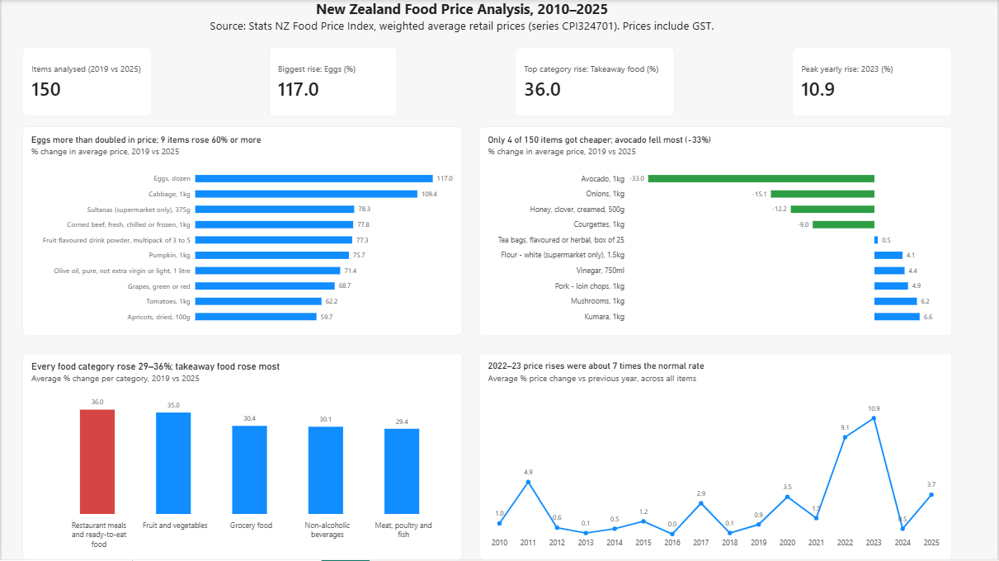
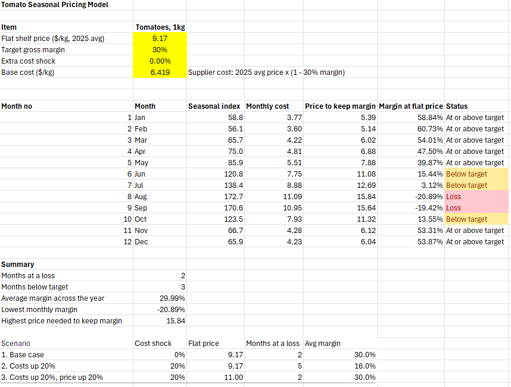
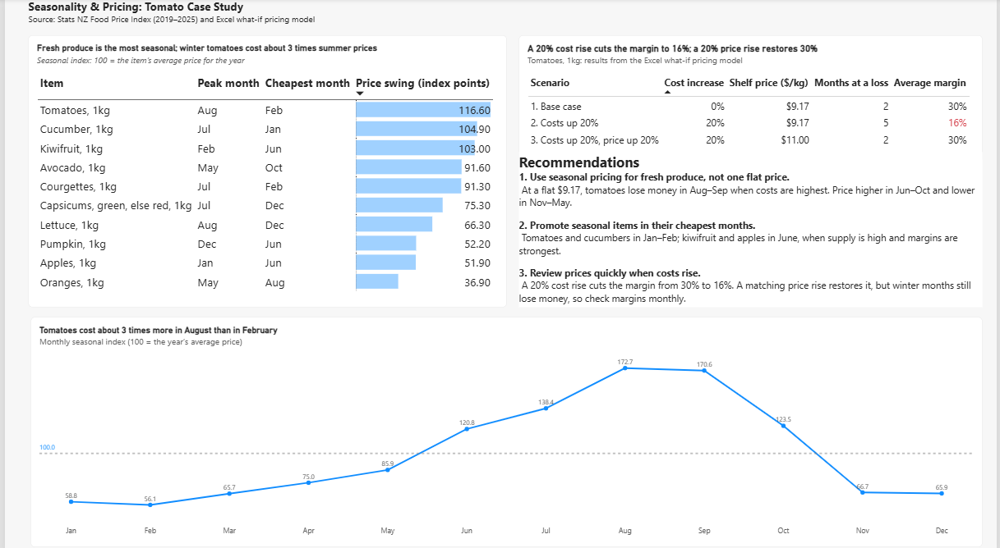

# NZ Grocery Price Analysis (2010–2025)

**An end-to-end retail pricing analysis of New Zealand food prices, from raw government data to business recommendations.**

`Excel (Power Query)` · `SQL (SQLite)` · `Power BI` · `DAX` · `What-if pricing model`



---

## Table of contents

1. [Executive summary](#1-executive-summary)
2. [Business problem](#2-business-problem)
3. [Business questions](#3-business-questions)
4. [Data](#4-data)
5. [Approach and workflow](#5-approach-and-workflow)
6. [Data preparation (Excel Power Query)](#6-data-preparation-excel-power-query)
7. [Analysis (SQL)](#7-analysis-sql)
8. [Pricing model (Excel)](#8-pricing-model-excel)
9. [Dashboard (Power BI)](#9-dashboard-power-bi)
10. [Key findings](#10-key-findings)
11. [Recommendations](#11-recommendations)
12. [Quality checks](#12-quality-checks)
13. [Limitations](#13-limitations)
14. [Next steps](#14-next-steps)
15. [How to use this repository](#15-how-to-use-this-repository)
16. [Data source and licence](#16-data-source-and-licence)

---

## 1. Executive summary

Food prices in New Zealand rose sharply between 2019 and 2025, but not evenly. Using 20 years of Stats NZ monthly price data, this project finds that:

- **Every food category rose by 29–36%.** Restaurant meals and ready-to-eat food rose most (+36.0%).
- **Eggs more than doubled (+117.0%)**, while **only 4 of 150 items got cheaper**.
- **2022 and 2023 were a price shock.** Prices rose 9.1% and 10.9%, about **7 times** the normal yearly rate of about 1.4% (2010–2021).
- **Fresh produce is highly seasonal.** Tomatoes cost about **3 times more in August than in February**.

A what-if pricing model shows why this matters for a retailer: **with one flat price, tomatoes lose money in August and September**, and a 20% cost rise cuts the average margin from **30% to 16%**. The main recommendation is to **use seasonal pricing for fresh produce** instead of one flat price.

---

## 2. Business problem

A grocery retailer must set prices that stay competitive for customers but still protect margins. Two things make this hard:

1. **Costs change over time.** Food prices have risen quickly in recent years, and some items rose much faster than others.
2. **Costs change within the year.** Fresh produce is cheap in its season and expensive out of season, so a single flat price can hide months of losses.

This project uses public data to show **which items and categories are under the most price pressure, when prices rise fastest, and how seasonality affects margins**, and then turns those findings into pricing recommendations.

---

## 3. Business questions

| # | Question | Why it matters for a retailer |
|---|---|---|
| Q1 | Which items had the **biggest price increases** between 2019 and 2025? | Shows where customers feel the most price pressure |
| Q2 | Which items had the **smallest increases or got cheaper**? | Shows items that can be used for value messaging and promotions |
| Q3 | How did **each food category** change? | Supports category-level pricing and range decisions |
| Q4 | How fast did prices rise **each year**, and was 2022–23 unusual? | Gives a "normal" baseline for planning and shows when to review prices |
| Q5 | Which items are the **most seasonal**, and when are they cheapest and most expensive? | Supports seasonal pricing and promotion timing |

All questions were written so that they can be **answered with a calculation** from the data, not opinion.

---

## 4. Data

| | |
|---|---|
| **Source** | Stats NZ, Food Price Index: monthly weighted average retail prices (Infoshare) |
| **Period downloaded** | 2006–2026 (monthly) |
| **Period analysed** | 2009–2025 (complete calendar years) |
| **Size after cleaning** | 35,803 rows (one row per item per month) |
| **Prices** | NZ dollars, including GST |

### Data dictionary (cleaned table: `fpi_prices_long.csv`)

| Column | Type | Description | Example |
|---|---|---|---|
| `Date` | Date (yyyy-mm-dd) | First day of the month | 2025-01-01 |
| `ItemFull` | Text | Full item name with unit | Tomatoes, 1kg |
| `Item` | Text | Item name only | Tomatoes |
| `Unit` | Text | Pack size or unit | 1kg |
| `Price` | Decimal | Average price for that month ($) | (price in $) |

### Lookup table (`category_lookup.csv`)

Maps each item to one of the 5 Stats NZ food price subgroups: **Fruit and vegetables**, **Meat, poultry and fish**, **Grocery food**, **Non-alcoholic beverages**, and **Restaurant meals and ready-to-eat food**.

---

## 5. Approach and workflow

```
Stats NZ download (wide format)
        │
        ▼
Excel Power Query ── clean, unpivot, split, validate ──► fpi_prices_long.csv
        │
        ▼
SQLite (DB Browser) ── 5 business questions in SQL ──► q1–q5 result CSVs
        │
        ├──► Excel ── what-if pricing model (tomatoes)
        │
        ▼
Power BI ── 2-page dashboard: trends, seasonality, pricing scenarios
```

Each tool was used for what it does best: **Power Query** for repeatable cleaning, **SQL** for the analysis logic, **Excel** for a transparent pricing model that a manager can change, and **Power BI** for communicating the results.

---

## 6. Data preparation (Excel Power Query)

The Stats NZ file comes in a **wide** format: one row per month and one column per item. This is hard to analyse, because every new month or item changes the structure.

| Step | What I did | Why |
|---|---|---|
| 1 | Removed header and footer notes from the download | Keep only the data rows |
| 2 | Built a proper `Date` column from the month labels | Allow time-based analysis |
| 3 | **Unpivoted** the item columns into rows | Convert to a **tidy long table** (Date, Item, Price) that works in SQL and Power BI |
| 4 | Split the item name at the **last comma** into `Item` and `Unit` | Item names contain commas (for example "Capsicums, green, else red, 1kg"), so only the last comma separates the unit |
| 5 | Trimmed text and set data types | Avoid matching errors |
| 6 | Removed error and blank prices | Missing months appear as blanks or symbols in the source |
| 7 | Exported as **CSV UTF-8** | Keep special characters (such as macrons and dashes) correct for SQL import |

Because these steps are saved in Power Query, the same cleaning can be **refreshed** when Stats NZ releases new data.

---

## 7. Analysis (SQL)

The cleaned CSV was loaded into **SQLite** (tables: `prices`, `category_lookup`). Scripts are in the [`sql`](sql) folder and run in numeric order.

### Method decisions

- **Annual averages, not single months.** An early version compared single months, but that mixes up price change with seasonal change (for example, a winter month against a summer month). Comparing **full-year averages (2019 vs 2025)** removes this seasonal bias.
- **Complete data only.** An item is included only if it has **all 12 months** in each year compared (`HAVING COUNT(*) = 12`). This gives a fair, like-for-like comparison (150 items for 2019 vs 2025).
- **Percentage change**, not dollar change, so that cheap and expensive items can be compared fairly.

### SQL techniques used

| Question | Techniques |
|---|---|
| Q1, Q2 | CTEs, `AVG` with `GROUP BY`, `HAVING` for completeness, `JOIN`, `ORDER BY … LIMIT` |
| Q3 | Q1 logic + `JOIN` to the category lookup, `COUNT`, `AVG`, `MIN`, `MAX` per category |
| Q4 | Yearly averages + a **self-join** (`cur.yr = prev.yr + 1`) for year-on-year change |
| Q5 | Monthly **seasonal index** (month price ÷ that year's average × 100) + **window function** `ROW_NUMBER() OVER (PARTITION BY …)` to find each item's peak and cheapest month |

<details>
<summary><b>Example query: Q1 (biggest price increases, 2019 vs 2025)</b></summary>

```sql
WITH year_2019 AS (
    SELECT ItemFull, AVG(Price) AS avg_2019
    FROM prices
    WHERE Date LIKE '2019%'
    GROUP BY ItemFull
    HAVING COUNT(*) = 12          -- only items with all 12 months
),
year_2025 AS (
    SELECT ItemFull, AVG(Price) AS avg_2025
    FROM prices
    WHERE Date LIKE '2025%'
    GROUP BY ItemFull
    HAVING COUNT(*) = 12
)
SELECT a.ItemFull,
       ROUND(a.avg_2019, 2) AS avg_price_2019,
       ROUND(b.avg_2025, 2) AS avg_price_2025,
       ROUND((b.avg_2025 - a.avg_2019) * 100.0 / a.avg_2019, 1) AS pct_change
FROM year_2019 a
JOIN year_2025 b ON a.ItemFull = b.ItemFull
ORDER BY pct_change DESC
LIMIT 10;
```
</details>

Results for each question are saved in [`data/results`](data/results) (GitHub shows them as tables).

---

## 8. Pricing model (Excel)

To show what seasonality means for profit, I built a **what-if pricing model** for tomatoes (1kg), the most seasonal item in the data.



### Inputs (yellow cells, can be changed)

| Input | Value | Note |
|---|---|---|
| Flat shelf price | $9.17/kg | 2025 average price |
| Target gross margin | 30% | Assumption |
| Extra cost shock | 0% | Used for scenarios |
| Base supplier cost | $6.419/kg | 2025 average price × (1 − 30%) |

### Logic (for each month)

| Column | Formula (in words) |
|---|---|
| Monthly cost | Base cost × seasonal index ÷ 100 × (1 + cost shock) |
| Price to keep margin | Monthly cost ÷ (1 − target margin) |
| Margin at flat price | (Flat price − monthly cost) ÷ flat price |
| Status | `IF` margin < 0 → **Loss**; `IF` margin < target → **Below target**; else **At or above target** |

A summary block counts loss months and below-target months (`COUNTIF`) and shows the average, lowest and highest values (`AVERAGE`, `MIN`, `MAX`). Absolute references (`$B$4`) keep the inputs fixed while the formulas fill down.

### Scenarios

| Scenario | Cost increase | Shelf price | Months at a loss | Average margin |
|---|---|---|---|---|
| 1. Base case | 0% | $9.17 | 2 | 30% |
| 2. Costs up 20% | 20% | $9.17 | 5 | **16%** |
| 3. Costs up 20%, price up 20% | 20% | $11.00 | 2 | 30% |

**Insight:** the yearly average margin can look healthy while individual months lose money. Even after a 20% price rise restores the 30% average, **August and September are still loss months**. A flat price cannot fix a seasonal cost problem.

---

## 9. Dashboard (Power BI)

### Page 1: Price Trends Overview


| Visual | Question | Design choice |
|---|---|---|
| 4 KPI cards | Headline numbers | Built from data fields (not typed) so they update automatically |
| Bar chart | Q1: top increases | Horizontal bars for long item names |
| Bar chart (two colours) | Q2: smallest increases | Green = price fell, blue = rose; bars go both ways from zero |
| Column chart | Q3: categories | Red highlights the top category; the axis starts at zero |
| Line chart | Q4: year-on-year change | Time order 2010→2025, straight lines (no smoothing) |

### Page 2: Seasonality & Pricing



| Visual | Purpose | Design choice |
|---|---|---|
| Table with data bars | Q5: most seasonal items, with peak and cheapest months | A table shows the months, which a bar chart cannot; data bars keep the ranking visual |
| Line chart | Tomato price pattern through the year | A dashed reference line at 100 (the yearly average) shows expensive and cheap months |
| Scenario table | Results of the Excel model | Red highlights the risk scenario |
| Text box | Recommendations | Turns the findings into actions |

### Power BI skills used

- **Action titles** that state the finding (for example, *"Only 4 of 150 items got cheaper"*) instead of generic titles
- **Rule-based conditional formatting** (green/blue bars, red risk values)
- **DAX calculated columns** to turn month numbers into names: `FORMAT(DATE(2000, [peak_month], 1), "MMM")`
- **Sort by column** (month names sorted by month number)
- **Analytics pane** constant line, data bars, **Enter data** tables
- A consistent layout, colour meaning and number format across both pages

---

## 10. Key findings

| # | Finding | Evidence |
|---|---|---|
| 1 | **Eggs more than doubled in price.** 9 items rose 60% or more. | Eggs +117.0%, cabbage +109.4%, sultanas +78.3% |
| 2 | **Only 4 of 150 items got cheaper.** | Avocado −33.0%, onions −15.1%, honey −12.2%, courgettes −9.0% |
| 3 | **Every food category rose 29–36%.** | Restaurant meals and ready-to-eat food +36.0%; fruit and vegetables +35.0%; grocery food +30.4%; non-alcoholic beverages +30.1%; meat, poultry and fish +29.4% |
| 4 | **2022–23 price rises were about 7 times the normal rate.** | 2010–2021 average ≈ 1.4% a year; 2022: 9.1%; 2023: 10.9%; 2024: 0.5%; 2025: 3.7% |
| 5 | **Fresh produce is the most seasonal.** All top 10 seasonal items are fruit or vegetables. | Tomatoes: index 172.7 in August vs 56.1 in February (about 3.1 times) |
| 6 | **A flat price hides seasonal losses.** | Tomatoes at $9.17: loss in August (−20.9%) and September (−19.4%) |

---

## 11. Recommendations

1. **Use seasonal pricing for fresh produce, not one flat price.**
   Price tomatoes higher in June–October and lower in November–May. This protects margin in winter and keeps prices competitive in summer.

2. **Promote seasonal items in their cheapest months.**
   For example, tomatoes and cucumbers in January–February, and kiwifruit and apples in June, when supply is high and margins are strongest.

3. **Review prices quickly when costs rise, and check margins monthly.**
   A 20% cost rise cuts the tomato margin from 30% to 16%. A matching price rise restores the yearly average, but winter months still lose money, so margins should be monitored by month, not only by year.

4. **Use the 2010–2021 rate (about 1.4% a year) as a planning baseline.**
   Price rises well above this level, as in 2022–23, should trigger a full price and margin review.

---

## 12. Quality checks

| Check | Result |
|---|---|
| Row count after cleaning | 35,803 rows |
| Complete-data rule | Only items with 12 months in each compared year |
| SQL vs Power BI | The "items analysed" card (150) matches the SQL result |
| Category totals | Items across the 5 categories add up to 150 |
| Chart titles vs exact numbers | Every title was re-checked after formatting. One title was corrected from "10 items rose 60% or more" to **"9 items"** when exact decimals showed apricots at 59.7% |
| Pricing model | Base cost checked by hand: $9.17 × (1 − 0.30) = $6.419 |

---

## 13. Limitations

- **Simple averages.** Category and yearly figures are simple averages across items, not weighted by how much households spend on each item. Official Stats NZ index figures use weights, so they will differ.
- **Category mapping.** Items were assigned to the 5 Stats NZ subgroups by me, based on item names.
- **Average prices, not shelf prices.** Stats NZ average prices are best for comparing **changes over time**, not exact prices at a particular store.
- **Pricing model assumptions.** The tomato supplier cost is an **assumption** (2025 average price with a 30% margin), not real supplier data. The model shows the **effect** of seasonality and cost changes; it is not a real pricing decision.
- **Seasonal index.** The index is an average pattern across years, so a single unusual year (for example, a weather event) can affect it.

---

## 14. Next steps

- Weight items by household spending (Stats NZ basket weights) for results closer to the official index
- Compare food price growth with wage growth, to measure real affordability
- Extend the pricing model to other seasonal items (cucumber, kiwifruit, courgettes)
- Forecast next year's prices using the seasonal pattern and recent trend
- Automate the monthly refresh (Power Query → SQL → Power BI)

---

## 15. How to use this repository

### Folder structure

```
nz-grocery-price-analysis/
├── README.md
├── data/
│   ├── raw/          Original Stats NZ download
│   ├── cleaned/      fpi_prices_long.csv, category_lookup.csv
│   └── results/      Q1–Q5 SQL results (CSV)
├── sql/              SQL scripts (run in numeric order)
├── excel/            grocery_price_analysis.xlsx (Power Query + pricing model)
├── powerbi/          grocery_price_dashboard.pbix
└── images/           Dashboard and model screenshots
```

### To reproduce the analysis

1. **Clean:** open `excel/grocery_price_analysis.xlsx` to see the Power Query steps, or use the ready file `data/cleaned/fpi_prices_long.csv`.
2. **Load:** in DB Browser for SQLite, create a new database and import `fpi_prices_long.csv` (as `prices`) and `category_lookup.csv` (as `category_lookup`).
3. **Analyse:** run the scripts in the `sql` folder in numeric order.
4. **Model:** open the `pricing_model` sheet in Excel and change the yellow input cells to test new scenarios.
5. **Dashboard:** open `powerbi/grocery_price_dashboard.pbix` in Power BI Desktop (free).

---

## 16. Data source and licence

Data: **Stats NZ**, Food Price Index (Infoshare). Stats NZ data is licensed under the [Creative Commons Attribution 4.0](https://creativecommons.org/licenses/by/4.0/) licence. This project is an independent analysis and is not endorsed by Stats NZ.

---

## About me

**Susmita Kumari Giri**
Master of Digital Business (AI and Business Analytics), University of Waikato. MBA in Finance.
Interested in **pricing analyst, commercial analyst and business analyst** roles in New Zealand.
